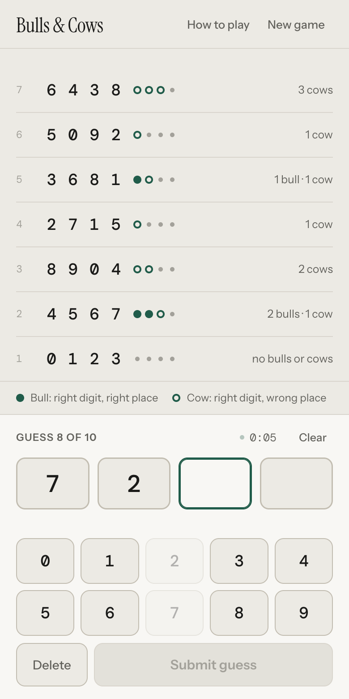
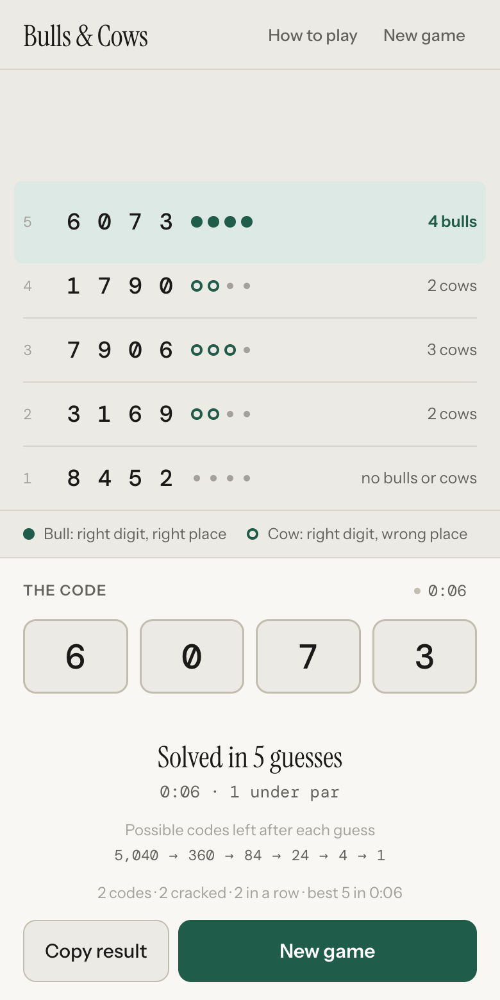

# Bulls & Cows

A four-digit code-breaking game for the browser. Ten guesses, a clock, and no help.

[](https://github.com/the-single-pivot/BullsAndCows/actions/workflows/ci.yml)

<p align="center">
  
  &nbsp;
  
</p>

The computer picks a code of four different digits. You guess, and every guess comes
back scored:

- a **bull** is a digit that is correct and in the right place
- a **cow** is a digit that is correct but in the wrong place

No digit repeats, and the code can start with 0, so there are 5,040 codes to pick from.
Four bulls wins. Spend all ten guesses and the code is revealed.

## The board keeps nothing for you

Most versions of this game mark up the keypad as you learn, or print how many codes are
still possible. This one does neither. The keypad stays blank, no counter tells you how
close you are, and every deduction is yours to make from the scored guesses and yours to
remember. Paper is allowed.

The clock starts on your first digit rather than when the page loads, so reading the rules
costs nothing. Tap it for the session record: codes played, how many you cracked, your
streak, fewest guesses, quickest time, and every finished game with its guess count and
time. That record lives in `sessionStorage`, so a refresh keeps it and closing the tab
clears it.

## Running it

Nothing to install, and the page itself needs no build. The dev server and the tests want
Node 20 or newer.

```sh
npm start          # http://localhost:8731
npm test           # the engine and the session record
npm run build      # the single-file versions in dist/
```

ES modules will not load over `file://`, so `index.html` needs a real origin. Use
`npm start`, or open `dist/bulls-and-cows.html`, which is the whole game in one file.

## Layout

```
index.html              the markup, and nothing else
src/engine.js           the rules: scoring, the 5,040-code universe, narrowing
src/session.js          the per-tab record of finished games
src/app.js              state and view, wired to the markup
src/styles.css          one stylesheet
test/                   node:test, no runner to install
tools/build.mjs         bundles the single-file and artifact versions into dist/
tools/serve.mjs         the dev server
design/directions.html  five art directions over one engine, kept as an archive
docs/                   the screenshots above
dist/                   generated: run npm run build after changing src/
```

`src/engine.js` is pure: no DOM, no storage, no clock. The tests cover it digit by digit,
including one fact the game leans on, that one bull and no cows from `0123` leaves exactly
480 codes and still rules out no single digit.

## Deploying

The site is static, so Vercel has nothing to build. `vercel.json` turns the build step
off, serves the repository root, and sets a content security policy that allows nothing
but this page's own files and the Google Fonts stylesheet.

```sh
vercel        # preview
vercel --prod
```

Or import `the-single-pivot/BullsAndCows` at vercel.com and keep the defaults.

## License

MIT. See [LICENSE](LICENSE).
